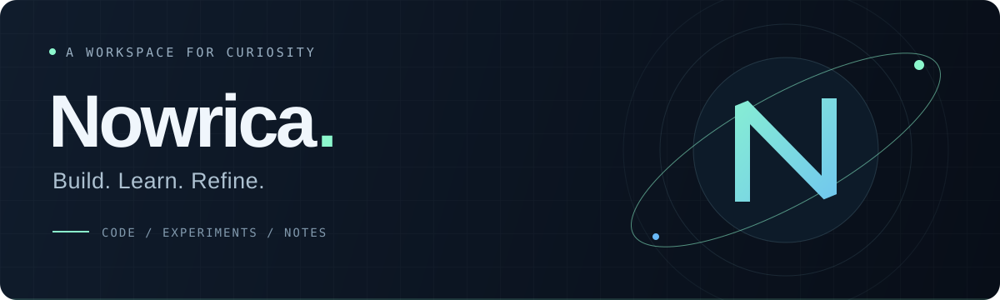

  

  <b>만들어 보고, 이해하고, 더 나은 코드로.</b>

 

<h2 align="center">KRDS</h2>

  
  &nbsp;
  
  &nbsp;
  

 

<h2 align="center">Community</h2>

  
  &nbsp;&nbsp;&nbsp;&nbsp;
  

  <a href="https://github.com/initializer-stack">initializer-stack ↗</a>
  &nbsp; · &nbsp;
  <a href="https://github.com/openportfolio">openportfolio ↗</a>

  

 

---

NOWRICA &nbsp; / &nbsp; Build. Learn. Refine.

