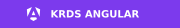

# Nowrica

I work on KRDS component libraries for Vue, React, and Angular, with a focus on accessibility, keyboard interaction, and clear documentation. I also build iStack and OpenPortfolio.

## Open source

<table>
  <thead><tr><th width="200">Project</th><th>Focus</th><th width="110">Explore</th></tr></thead>
  <tbody>
    <tr>
      <td width="200"></td>
      <td>Vue 3 and TypeScript components with browser-based accessibility tests.</td>
      <td><a href="https://krds.initializer.org/">Docs</a></td>
    </tr>
    <tr>
      <td width="200"></td>
      <td>A port of the official KRDS React package, with Next.js App Router support.</td>
      <td><a href="https://react.krds.initializer.org/">Docs</a></td>
    </tr>
    <tr>
      <td width="200"></td>
      <td>Angular components using native form controls and KRDS styles. In early development.</td>
      <td><a href="https://github.com/Initializer-org/krds-angular">Source</a></td>
    </tr>
    <tr>
      <td width="200"></td>
      <td>A monorepo template connecting services and clients across languages through OpenAPI and gRPC contracts.</td>
      <td><a href="https://github.com/initializer-stack/template">Source</a> · <a href="https://stack.initializer.org/">Docs</a></td>
    </tr>
    <tr>
      <td width="200"></td>
      <td>A self-hosted Toss Securities dashboard for live holdings, sector exposure, strategy tracking, and backtesting. Korean-language UI.</td>
      <td><a href="https://github.com/openportfolio/dashboard">Source</a> · <a href="https://openportfolio.github.io/dashboard/">Docs</a></td>
    </tr>
  </tbody>
</table>

## Now

Exploring accessible UI patterns, shared API contracts, and tools that work locally.

## Notes

Selected guides and design notes from my projects. Written in Korean.

- [Architecture decisions in iStack](https://github.com/initializer-stack/template/blob/main/docs/decisions/README.md) — Why the stack uses code-first HTTP contracts, shared gRPC definitions, and PostgreSQL.
- [Testing against real infrastructure](https://github.com/initializer-stack/template/blob/main/docs/concepts/testing.md) — What API integration tests verify, from HTTP requests to database writes.
- [Building KRDS interfaces with coding agents](https://github.com/Initializer-org/krds-vue/blob/main/docs/guide/ai.md) — Project instructions and documentation for AI-assisted UI development.

---

Build. Learn. Refine.
